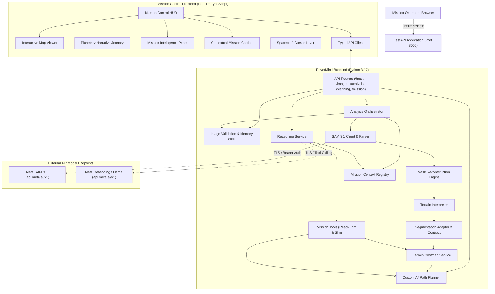
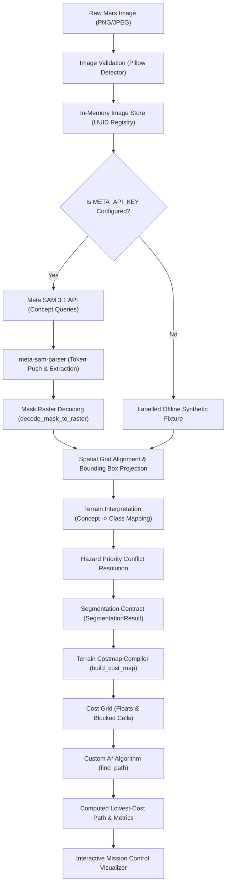
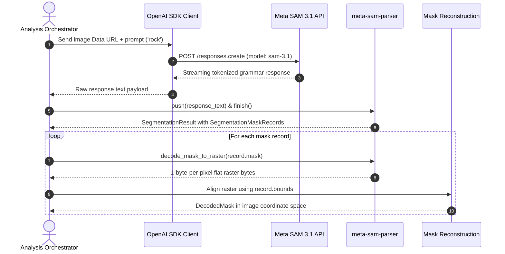
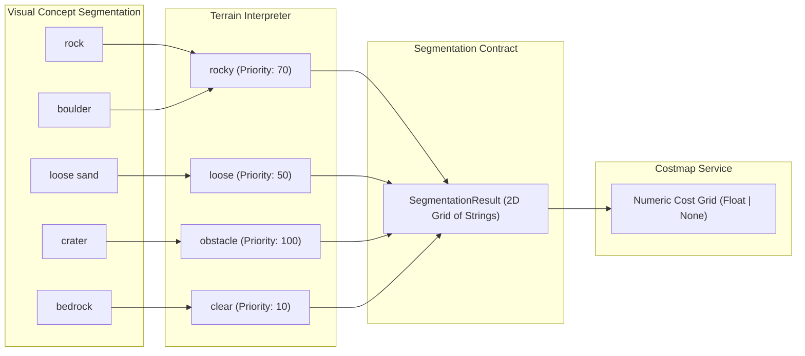
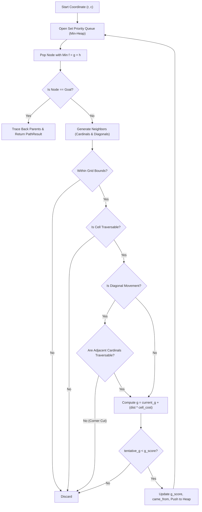
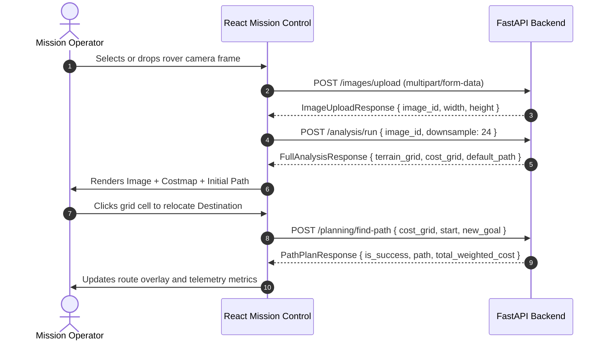

# RoverMind — System Architecture

This document describes the software architecture, modular relationships, external integrations, and data flows of the **RoverMind** application.

---

## 1. High-Level System Architecture

RoverMind is divided into two decoupled subsystems:

1. **FastAPI Backend Services**: Responsible for image integrity validation, model orchestration, mask parsing and decoding, terrain normalization, costmap compilation, and authoritative A* route finding.
2. **React + TypeScript Mission Control Frontend**: Responsible for image ingestion, user coordinate interactions, spatial layer visualization (raw image, mask overlay, costmap grid, and path overlay), and telemetry diagnostics.

---

## 2. End-to-End Processing Pipeline

The execution flow begins with an uploaded optical image and terminates with an interactive route overlay on the user's display:

---

## 3. Meta SAM 3.1 Integration Architecture

Visual segmentation uses Meta AI's promptable SAM 3.1 model. SAM streaming outputs return custom tokenized grammar rather than raw raster PNGs. RoverMind parses this data using `meta-sam-parser`:

---

## 4. Terrain Normalization & Costmap Compilation

Visual concepts are distinct from operational terrain traversal parameters. The translation occurs through an explicit multi-stage normalization contract:

---

## 5. Custom A* Route-Planning Flow

The path-planning engine is strictly authoritative on the backend. The search algorithm explores the cost grid while enforcing corner-cutting constraints:

---

## 6. Frontend / Backend Communication

The browser interface communicates with the FastAPI backend through a typed API client:

