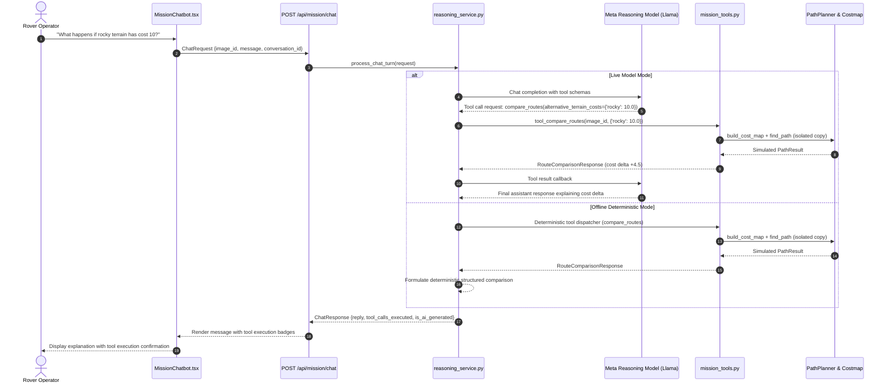

# RoverMind — Contextual Mission Assistant & Tool Interface

This document specifies the technical design, tool definitions, execution lifecycle, and conversation management of the RoverMind Mission Chatbot.

---

## 1. Overview & Architectural Principles

The RoverMind Mission Chatbot is not a generic free-form conversational agent. It is a **context-grounded planetary mission assistant** designed to answer operator questions strictly using verified telemetry from the active image analysis.

### Core Principles:
- **Active Mission Scoping**: Every message is validated against an active `image_id` stored in the backend registry. Conversations cannot bleed between images.
- **Strict Read-Only Default**: Tools cannot modify server configuration, delete images, or overwrite the active route.
- **Non-Destructive Simulation**: The `compare_routes` tool recomputes costmaps and A* paths on an isolated copy without mutating the original mission analysis.
- **Bounded Tool Iterations**: Up to 4 tool iterations per turn.
- **Zero Hallucination of Quantities**: Exact obstacle counts, waypoints, and costs are fetched directly from backend services.

---

## 2. Controlled Tool Interface (`backend/app/services/mission_tools.py`)

The assistant has access to 6 strictly validated tools:

### 1. `get_mission_summary(image_id: str)`
- **Purpose**: Returns high-level mission metadata, resolution, model provenance, and route status.
- **Parameters**: `image_id` (string)
- **Output**: Dictionary with `filename`, `resolution`, `grid_resolution`, `segmentation_model`, `is_synthetic`, `route_found`, `total_cost`.

### 2. `get_terrain_distribution(image_id: str)`
- **Purpose**: Returns verified terrain class cell counts, percentages, and unknown/unmapped statistics.
- **Parameters**: `image_id` (string)
- **Output**: `total_cells`, `cell_counts` (`clear`, `loose`, `rocky`, `obstacle`, `unknown`), `percentages`, `configured_costs`.

### 3. `get_region_details(image_id: str)`
- **Purpose**: Returns segmented concept masks, bounding boxes, and pixel surface areas (capped at top 20 records).
- **Parameters**: `image_id` (string)
- **Output**: List of mask records with `object_id`, `concept`, `area_pixels`, `bounds`.

### 4. `get_route_metrics(image_id: str)`
- **Purpose**: Returns pathfinding telemetry, waypoints count, weighted cost, and search node complexity.
- **Parameters**: `image_id` (string)
- **Output**: `is_success`, `waypoints_count`, `total_weighted_cost`, `geometric_length`, `expanded_nodes`.

### 5. `compare_routes(image_id: str, alternative_terrain_costs: Dict[str, Optional[float]], allow_diagonal: Optional[bool] = None)`
- **Purpose**: Non-destructively recalculates a simulated path using alternative traversal costs.
- **Parameters**:
  - `image_id` (string)
  - `alternative_terrain_costs` (map of terrain label to alternative cost, e.g. `{"rocky": 10.0}`)
  - `allow_diagonal` (optional boolean, defaults to active setting)
- **Output**: `RouteComparisonResponse` containing `original_cost`, `alternative_cost`, `cost_delta`, `length_delta`, `comparison_summary`, and `alternative_path`.

### 6. `get_analysis_diagnostics(image_id: str)`
- **Purpose**: Returns execution logs, fallback notices, and scientific limitation reminders.
- **Parameters**: `image_id` (string)
- **Output**: `segmentation_model`, `is_synthetic`, `diagnostics`, `scientific_limitations`.

---

## 3. Tool Calling & Conversation Lifecycle

---

## 4. Conversation History Management

- **Storage**: In-memory thread-safe `OrderedDict` (`_CONVERSATION_STORE`).
- **Session Capacity**: Bounded to at most 25 active concurrent conversations.
- **Message Depth**: Bounded to at most 20 messages per conversation to avoid token overflow.
- **Mission Isolation**: Switching images in the frontend automatically resets the active conversation ID, preventing context mixing across different surface frames.
